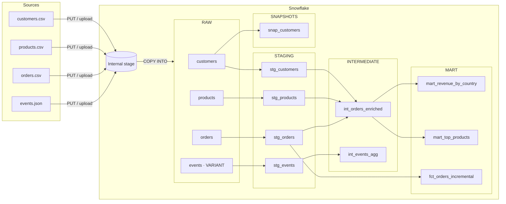

# E-commerce Data Platform — Snowflake & dbt

End-to-end analytics platform for an e-commerce company, built on **Snowflake** with **dbt**.
It covers the full data lifecycle: secured environment (RBAC), raw ingestion of CSV and JSON files,
a medallion architecture (RAW → STAGING → INTERMEDIATE → MART), incremental loading,
SCD type 2 history, automated data quality tests and generated documentation.

---

## Architecture



| Layer | Snowflake schema | dbt materialization | Purpose |
|---|---|---|---|
| Sources | `RAW` | tables | Data loaded as-is with `COPY INTO` (CSV + JSON as `VARIANT`) |
| Staging | `STAGING` | views | One model per source: renaming, typing, JSON parsing |
| Intermediate | `INTERMEDIATE` | views | Joins and aggregations |
| Marts | `MART` | tables / incremental | Business-ready tables for analysts |
| Snapshots | `SNAPSHOTS` | snapshot | Customer history (SCD type 2) |

---

## Tech stack

- **Snowflake**: storage, compute (virtual warehouses), RBAC, internal stage, `COPY INTO`, semi-structured data (`VARIANT`)
- **dbt Core** 1.12 with the **dbt-snowflake** adapter
- **SQL + Jinja** (models, macros, custom tests)
- **Python** virtual environment

---

## Repository structure

```
.
├── data/                          # Source files (CSV + newline-delimited JSON)
├── snowflake_sql/                 # Snowflake setup, run in order
│   ├── 01_security.sql            # Roles, user, account privileges (RBAC)
│   ├── 02_infrastructure.sql      # Warehouse, database, medallion schemas, analyst access
│   ├── 03_ingestion.sql           # Stage, file formats, RAW tables, COPY INTO
│   ├── 04_exploratory_analysis.sql
│   ├── 05_validation.sql          # Post-build checks
│   └── demos/                     # Incremental, snapshot and data-quality demos
├── Project_Snow_DBT/              # dbt project
│   ├── dbt_project.yml            # Layer → schema and materialization mapping
│   ├── models/
│   │   ├── staging/               # _sources.yml, stg_*.sql, tests and docs
│   │   ├── intermediate/          # int_orders_enriched, int_events_agg
│   │   ├── marts/                 # mart_revenue_by_country, mart_top_products, fct_orders_incremental
│   │   └── overview.md            # Documentation home page
│   ├── macros/                    # convert_amount, generate_schema_name
│   ├── snapshots/                 # snap_customers (SCD type 2)
│   └── tests/                     # Custom singular and generic tests
├── requirements.txt
└── README.md
```

---

## dbt project highlights

### Models
| Model | Description |
|---|---|
| `stg_customers`, `stg_products`, `stg_orders` | Cleaned and typed source tables |
| `stg_events` | JSON parsing of the `VARIANT` column (`raw_data:user_id::string`) |
| `int_orders_enriched` | Orders joined with customers and products |
| `int_events_agg` | Events per user, broken down by type |
| `mart_revenue_by_country` | Revenue per country in EUR and USD, share of total |
| `mart_top_products` | Product performance and sales ranking |
| `fct_orders_incremental` | Incremental model (`merge` on `order_id`): only new rows are processed |

### Snapshot
`snap_customers` tracks changes to customer attributes using the `check` strategy.
Each change closes the previous version (`dbt_valid_to`) and inserts a new one.

### Macros
- `convert_amount(column, rate, decimals)`: reusable currency conversion, used in the marts
- `generate_schema_name`: override so models are built in the exact medallion schemas (`MART`, not `STAGING_MART`)

### Data quality: 47 tests
- Generic tests on every critical column: `unique`, `not_null`, `relationships` (foreign keys), `accepted_values`
- Custom singular test `assert_no_negative_amount`
- Custom generic test `positive_amount`, reused across models

### Documentation
Every source, model, column, test, macro and snapshot is documented.
Generated with `dbt docs generate`, including the full lineage graph.

---

## Getting started

### 1. Snowflake setup
Run the scripts in `snowflake_sql/` in order (01 → 04) in a Snowflake worksheet.
Replace `<YOUR_PASSWORD>` in `01_security.sql` and upload the files from `data/` to the stage.

### 2. Python environment
```bash
python -m venv .venv
# Windows
.venv\Scripts\activate
# macOS / Linux
source .venv/bin/activate

pip install -r requirements.txt
```

### 3. dbt profile
Create `~/.dbt/profiles.yml` (never commit this file):

```yaml
Project_Snow_DBT:
  target: dev
  outputs:
    dev:
      type: snowflake
      account: <ORG>-<ACCOUNT>
      user: DBT_ENGINEER_USER
      password: "<YOUR_PASSWORD>"
      role: DATA_ENGINEER
      warehouse: ECOMMERCE_WH
      database: ECOMMERCE_DB
      schema: STAGING
      threads: 4
```

### 4. Build
```bash
cd Project_Snow_DBT
dbt debug                # check the connection
dbt build                # models + snapshot + tests, in dependency order
dbt docs generate        # build the documentation
dbt docs serve           # open it at http://localhost:8080
```

Expected result: `PASS=57 WARN=0 ERROR=0` (9 models, 1 snapshot, 47 tests).

---

## Author

**Nourimane Kerroumi**, Data Scientist & AI Engineer
